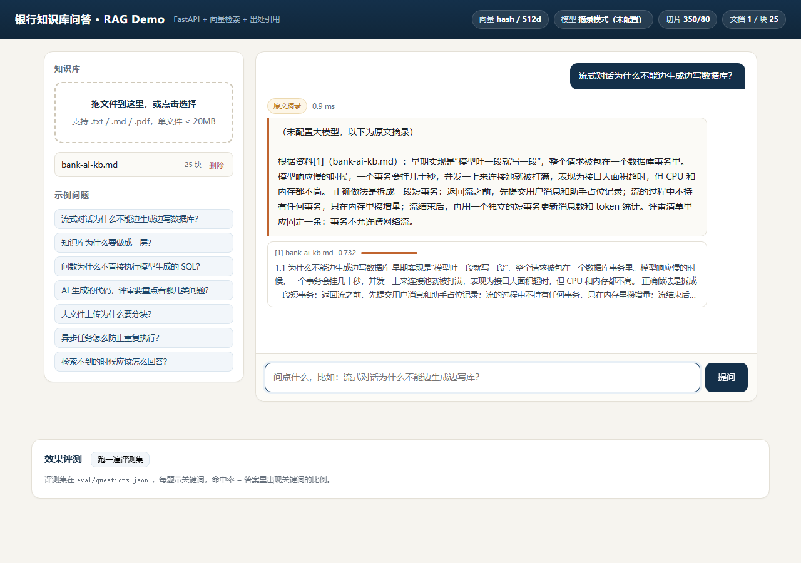

# RAG Demo · 银行知识库问答

一个能跑起来的最小 RAG：上传文档 → 切块 → 检索 → 生成答案 → **带出处**。
零 API Key 也能跑（自动降级为原文摘录），配了模型就换成大模型回答。

**技术栈**：FastAPI · 向量检索（本地 hashing，可切远端 embedding API）· BM25 混合排序 · 无构建单页前端



## 30 秒跑起来

```bash
python -m venv .venv
.venv\Scripts\activate            # macOS/Linux: source .venv/bin/activate
pip install -r requirements.txt

uvicorn app.main:app --port 8123
# 打开 http://127.0.0.1:8123
```

上传 `data/corpus/bank-ai-kb.md`（或任何 PDF/TXT/MD），然后问：

- 流式对话为什么不能边生成边写数据库？
- 问数为什么不直接执行模型生成的 SQL？
- 公司年假有几天？（**应该拒答**）

## 三分钟演示

1. 上传 `data/corpus/bank-ai-kb.md` → 显示「25 个片段」；再传一次 → 显示「内容重复，已跳过」（**幂等**）
2. 问「流式对话为什么不能边生成边写数据库？」→ 答案带出处卡片和覆盖率，模式显示「原文摘录」
3. 问「公司年假有几天？」→ 直接回答「资料里没有找到相关内容」（**拒答**，不是硬编）
4. 点「跑一遍评测集」→ 10 题命中率 100%，平均 0.5 ms
5. 讲三个坑：切片过大、去掉拒答阈值、去掉去重（见 `docs/三个坑.md`）

> 首次运行会在 `data/index.json` 生成索引，该文件不入库（`.gitignore` 已排除）。

## 目录

```
app/
  chunking.py    文本解析 + 切块（标题即边界）
  embedding.py   向量化：本地 hashing / 远端 API 两种
  store.py       BM25 + 覆盖率检索，向量分辅助
  llm.py         大模型调用 + 无 Key 时的摘录降级
  rag.py         入库、问答、评测编排
  main.py        FastAPI 路由
web/index.html   单页前端（无构建、无 CDN）
eval/            评测集（10 题，带关键词）
tests/           7 个单测
docs/三个坑.md    故意改坏的三处 + 修法
```

## 关键设计

**1. 切块跟着标题走，不按固定窗口硬切**
中文没有空格，硬切会把一句话砍成两半。更致命的是把两节内容混进一个块——问 A 小节，检索命中的块里前一半是 B 小节，摘出来的就是 B 的内容。所以标题就是切块边界。

**2. 排序用 BM25，不用纯余弦**
中文短问句只有十几个 token，对上一个几百字的块，余弦会被长度稀释：正相关问题只有 0.1 左右，和噪声分不开。BM25 自带长度归一和 IDF，排序稳得多。向量分只作为参考展示。

**3. 拒答看「关键词覆盖率」，不看相似度**
覆盖率 = 问题里 IDF 加权的关键词，有多大比例在这段原文里出现过。实测：本领域问题 0.25–0.87，无关问题 0.0。阈值 0.2 留足余量。
**拒答不是失败，编造才是事故。**

**4. 入库按内容指纹去重**
`sha256(文件)` 做幂等键，同一份内容传两次只留一份。少了这一步，检索会重复命中、答案会重复引用——和异步任务「重复消费」是同一个病。

**5. 模型不可用要降级，不能让整个问答挂掉**
没配 Key → 原文摘录；调用超时/5xx → 自动降级并标注原因。演示环境不能因为没 Key 就跑不起来。

## 接口

| 方法 | 路径 | 说明 |
|---|---|---|
| POST | `/api/upload` | multipart 上传，返回块数；重复文件返回 `deduped: true` |
| POST | `/api/ask` | `{question, top_k?}`，返回答案、模式、出处、耗时 |
| GET | `/api/docs` | 文档列表 |
| DELETE | `/api/docs/{id}` | 删除文档并重建索引 |
| POST | `/api/eval` | 跑评测集，返回命中率与逐题结果 |
| GET | `/api/stats` | 向量方式、模型状态、切片参数 |

## 评测

```bash
curl -X POST http://127.0.0.1:8123/api/eval
```

当前结果：**10/10 命中，平均 0.5 ms**（本地 hashing 向量 + 摘录模式，不含模型耗时）。

## 三个坑

见 [docs/三个坑.md](docs/三个坑.md)：切片过大、去掉拒答阈值、去掉去重。每处都写了怎么复现、会看到什么、怎么修。

## 已知局限

- 向量是字符二元组哈希，不是语义向量：换个说法（「事务挂住」vs「长事务」）就召不回。生产要换 bge/m3e 这类中文 embedding。
- 只有词法相关性，没有重排（rerank）环节。
- 单机单进程、JSON 落盘，没有并发控制，不适合多实例。
- 没有权限体系：谁能问、能看哪些文档，生产必须做。

## 为什么不用 LangChain / Chroma

这个规模（几十个块、单机演示）用不上：引入框架会让「哪一步出错」变得难定位，面试时也讲不清边界。
把切块、检索、生成拆成四个文件，每一步都能单独测、单独换——要换 Milvus 只改 `store.py`，要换模型只改 `llm.py`。
